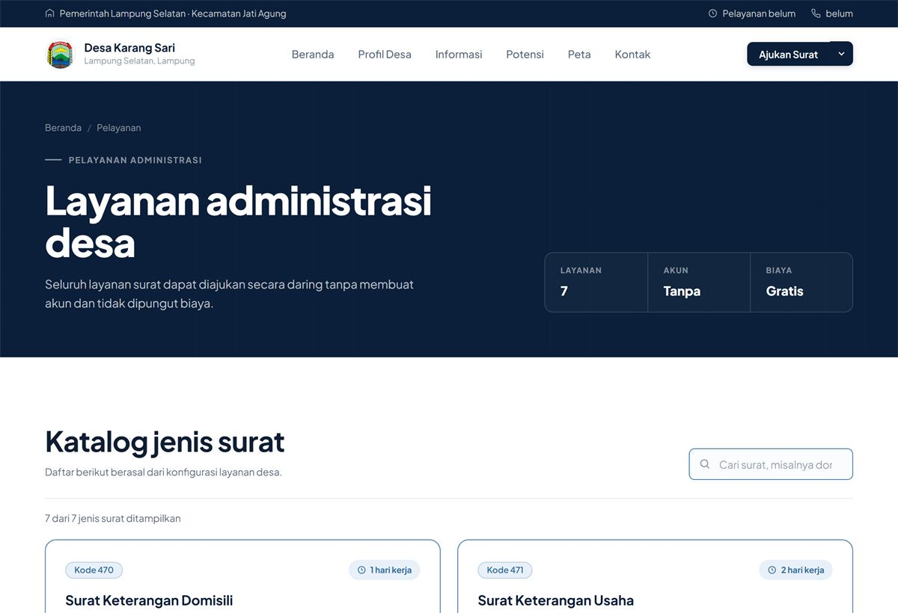
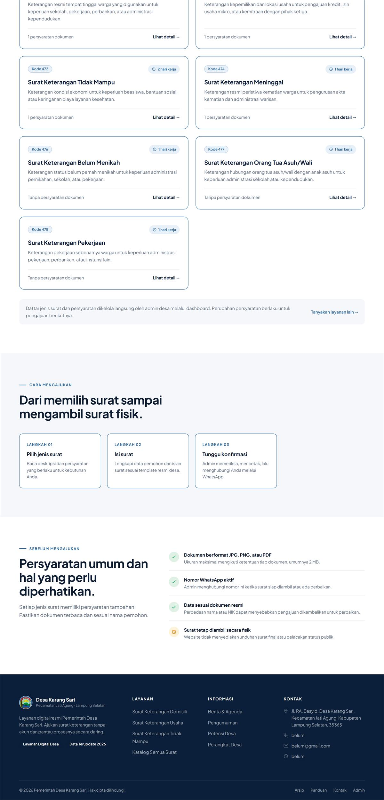
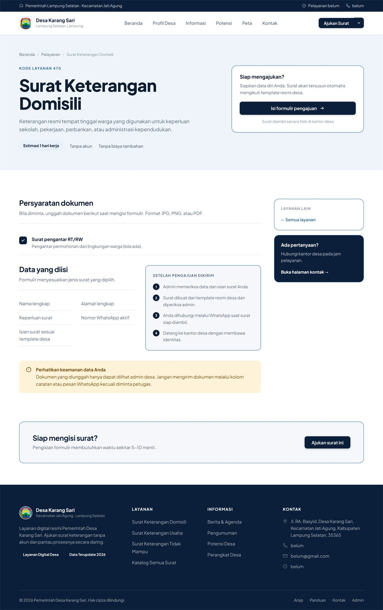
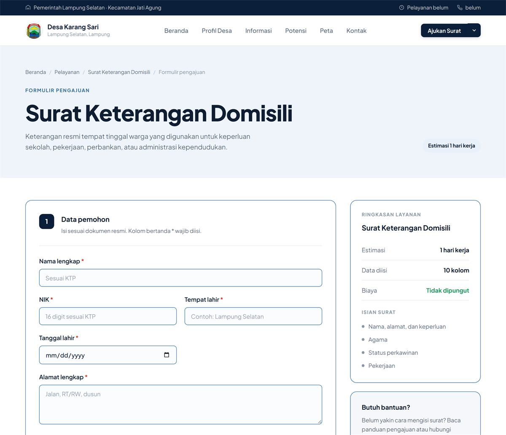
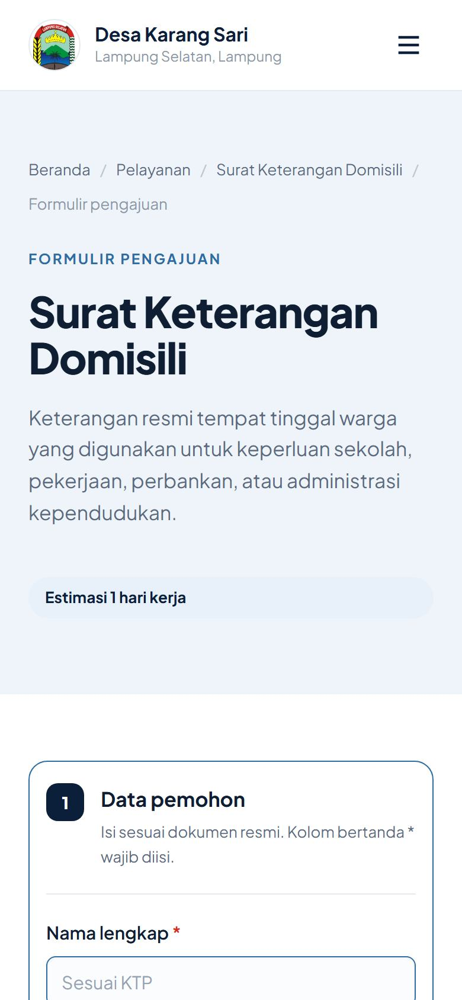
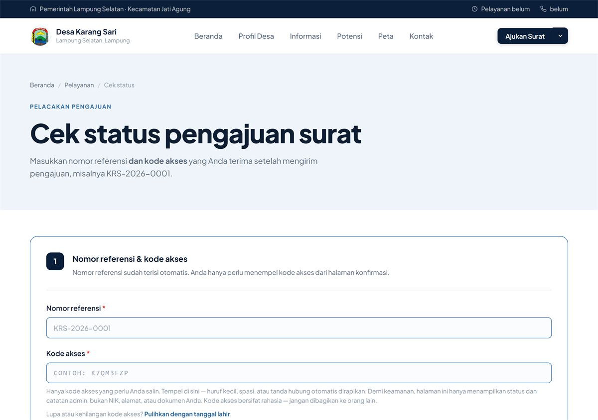
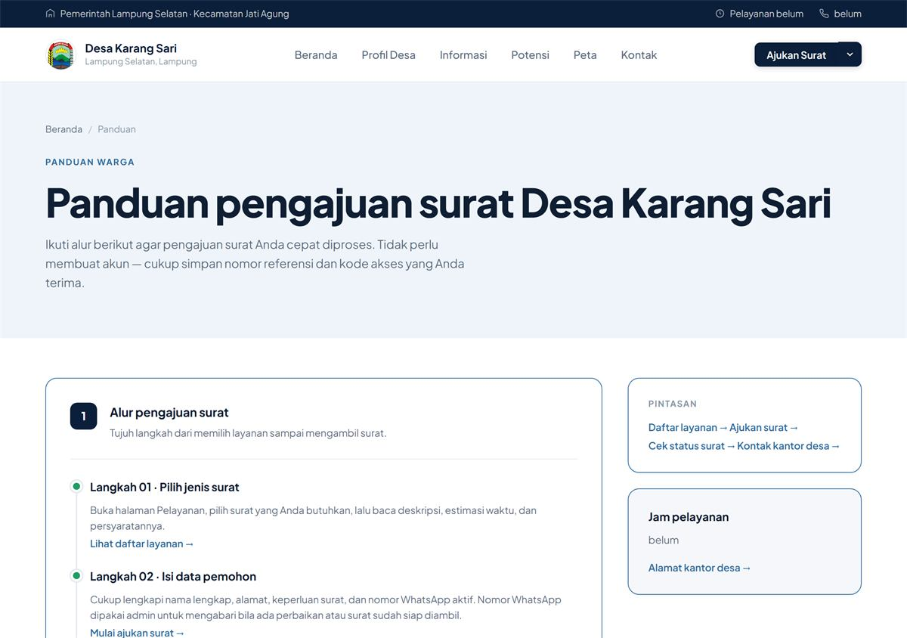

<div align="center">

# Website Resmi Desa Karang Sari

Sistem informasi desa dan pelayanan surat daring untuk **Desa Karang Sari**, Kecamatan Jati Agung, Kabupaten Lampung Selatan, Provinsi Lampung.

Warga mengajukan surat keterangan secara daring dan memantau statusnya tanpa membuat akun. Perangkat desa mengelola pengajuan dan seluruh konten situs dari satu dashboard.

[](https://laravel.com)
[](https://www.php.net)
[](https://www.postgresql.org)
[](https://vite.dev)
[](https://phpunit.de)
[](#pengujian)
[](https://railway.com)

Situs live: **<https://desa-karangsari.up.railway.app>**

[Tentang](#tentang-proyek) &middot; [Fitur](#fitur) &middot; [Layanan Surat](#layanan-surat) &middot; [Alur Pengajuan](#alur-pengajuan-surat) &middot; [Instalasi](#instalasi) &middot; [Pengujian](#pengujian) &middot; [Keamanan](#keamanan) &middot; [Deploy](#deploy-ke-railway) &middot; [Tim](#tim-pengembang)

</div>

---

## Tentang Proyek

Website Desa Karang Sari menggantikan situs statis menjadi sistem terpadu. Sebelumnya warga harus datang ke kantor desa untuk mengurus surat keterangan dan menanyakan perkembangannya. Sekarang seluruh proses pengajuan berjalan daring, dan statusnya dapat dipantau kapan saja memakai nomor referensi.

Repositori ini berisi dua bagian:

| Bagian | Lokasi | Keterangan |
| :--- | :--- | :--- |
| **Prototipe desain** | akar repositori (`index.html`, `admin/`, `css/`, `js/`) | Acuan tampilan awal. Tidak diubah, dipertahankan sebagai rujukan desain. |
| **Aplikasi Laravel** | `backend/` | Aplikasi yang berjalan: situs publik, dashboard admin, basis data, unggah dokumen, autentikasi. |

Aplikasi Laravel adalah hasil migrasi dari prototipe statis tersebut. Seluruh identitas desa, konten berita, potensi, dan struktur perangkat diambil dari basis data, bukan ditulis di dalam kode.

### Alamat halaman

| Halaman | Alamat | Akses |
| :--- | :--- | :--- |
| Beranda | `/` | Publik |
| Profil desa | `/profil` | Publik |
| Informasi | `/informasi` | Publik |
| Potensi desa | `/potensi` | Publik |
| Kontak | `/kontak` | Publik |
| Katalog layanan | `/pelayanan` | Publik |
| Pengajuan surat | `/pengajuan` | Publik |
| Cek status pengajuan | `/cek-status` | Publik |
| Panduan warga | `/panduan` | Publik |
| Dashboard admin | `/admin` | Perlu login |
| Panduan admin | `/admin/panduan` | Perlu login |
| Pemeriksaan kesehatan | `/up` | Publik |

---

## Fitur

### Situs publik

| Fitur | Keterangan |
| :--- | :--- |
| **Beranda** | Sekilas desa, layanan populer, berita dan agenda terbaru |
| **Profil desa** | Sejarah, visi dan misi, struktur pemerintahan, wilayah, demografi, keadaan sosial, riwayat kepala desa |
| **Informasi** | Berita, pengumuman, dan agenda desa dengan penyaringan kategori |
| **Potensi desa** | Potensi unggulan beserta deskripsi dan foto |
| **Kontak** | Alamat, telepon, WhatsApp, jam layanan, dan peta lokasi |
| **Katalog layanan** | Tujuh jenis surat beserta persyaratan dan estimasi waktu |
| **Pengajuan surat daring** | Formulir tervalidasi dengan nomor referensi dan kode akses |
| **Cek status** | Warga memantau pengajuan memakai nomor referensi dan kode akses |
| **Revisi mandiri** | Warga memperbaiki isian yang dikembalikan petugas tanpa membuat pengajuan baru |
| **Panduan warga** | Petunjuk penggunaan layanan dalam bahasa awam |

### Dashboard admin

| Fitur | Keterangan |
| :--- | :--- |
| **Ringkasan** | Statistik pengajuan dan daftar yang menunggu tindakan |
| **Verifikasi pengajuan** | Ubah status, beri catatan, lihat riwayat, unduh dokumen |
| **Verifikasi per berkas** | Setujui atau tolak tiap dokumen yang diunggah warga |
| **Unduh surat Word** | Surat jadi dibuat dari kerangka resmi desa |
| **Kelola berita dan agenda** | CRUD dengan unggah foto dan sorotan beranda |
| **Kelola potensi desa** | CRUD potensi unggulan |
| **Kelola statistik beranda** | Angka ringkas yang tampil di beranda |
| **Kelola perangkat desa** | CRUD dengan foto, jabatan, dan NIP |
| **Kelola jenis surat** | Template surat, kolom isian, dan persyaratan |
| **Kelola konten website** | Teks halaman publik yang dapat disunting |
| **Profil dan kontak desa** | Identitas desa, logo, peta, batas wilayah, penggunaan lahan |
| **Kelola akun admin** | CRUD akun berbasis peran |
| **Log aktivitas** | Mencatat seluruh tindakan admin, termasuk pembukaan dokumen warga |

### Peran pengguna

| Peran | Kewenangan |
| :--- | :--- |
| **Administrator** | Semua fitur, termasuk kelola akun admin dan pengaturan profil desa |
| **Verifikator** | Verifikasi dan ubah status pengajuan, verifikasi dokumen, kelola jenis surat |
| **Operator Konten** | Kelola berita, potensi, statistik, perangkat desa, konten, dan profil |

Halaman pengajuan (daftar, detail, unduh dokumen warga) hanya dapat diakses Administrator dan Verifikator. Operator Konten tidak melihat data warga sama sekali, termasuk menu dan kotak ringkasannya.

---

## Layanan Surat

Situs menyediakan tujuh jenis surat keterangan. Jumlah, deskripsi, persyaratan, dan estimasi waktu seluruhnya dibaca dari basis data, sehingga perangkat desa dapat mengubahnya lewat dashboard tanpa menyentuh kode.

| Kode | Layanan | Estimasi |
| :--- | :--- | :--- |
| 470 | Surat Keterangan Domisili | 1 hari kerja |
| 471 | Surat Keterangan Usaha | 2 hari kerja |
| 472 | Surat Keterangan Tidak Mampu | 2 hari kerja |
| 474 | Surat Keterangan Meninggal | 1 hari kerja |
| 476 | Surat Keterangan Belum Menikah | 1 hari kerja |
| 477 | Surat Keterangan Orang Tua Asuh/Wali | 1 hari kerja |
| 478 | Surat Keterangan Pekerjaan | 1 hari kerja |

Seluruh layanan **tidak dipungut biaya** dan tidak memerlukan akun.

### Katalog layanan

Halaman `/pelayanan` menampilkan seluruh jenis surat beserta pencarian, kode layanan, estimasi waktu, dan jumlah persyaratan. Setiap kartu mengarah ke halaman detail yang menjelaskan persyaratan dokumen, data yang perlu diisi, dan langkah setelah pengajuan dikirim.





### Detail layanan

Halaman detail menjelaskan apa yang harus disiapkan sebelum mengisi formulir, termasuk persyaratan dokumen dan perkiraan waktu pengisian. Tersedia juga peringatan keamanan data agar warga tidak mengirim dokumen lewat jalur yang salah.



### Formulir pengajuan

Formulir menyesuaikan jenis surat yang dipilih. Kolom isian diturunkan otomatis dari template resmi desa, sehingga penanda seperti nama desa dan tanggal terisi sendiri, sedangkan warga hanya mengisi data yang memang diperlukan.

Panel samping menampilkan ringkasan layanan: estimasi waktu, jumlah kolom, biaya, dan daftar isian surat.



Tampilan ponsel menyesuaikan satu kolom, dengan panel ringkasan berpindah ke bawah formulir.

<div align="center">

</div>

### Cek status pengajuan

Warga memantau pengajuan memakai nomor referensi dan kode akses. Halaman ini sengaja hanya menampilkan status dan catatan admin, bukan NIK, alamat, atau dokumen, sehingga aman dibuka di perangkat bersama.

Bila kode akses hilang, warga memulihkannya lewat `/cek-status/lupa-kode` memakai nomor referensi dan tanggal lahir, dibatasi 8 percobaan per 10 menit.



### Panduan warga

Panduan berisi tujuh langkah pengajuan dalam bahasa awam. Halaman ini tidak memerlukan login dan berguna saat petugas mendampingi warga di kantor desa. Isinya dapat disunting lewat menu **Kelola Konten Website**.



> Seluruh tangkapan layar di atas diambil dari situs live dan tidak memuat data warga. Halaman dashboard admin sengaja tidak disertakan karena memuat data pribadi pemohon.

---

## Alur Pengajuan Surat

```
1. Warga pilih layanan
   - isi data pemohon (nama, alamat, keperluan, WhatsApp)
   - isian surat otomatis diturunkan dari template resmi ({{penanda}})

2. Warga menerima
   - nomor referensi  -> KRS-2026-0001   (untuk komunikasi dengan petugas)
   - kode akses acak  -> K7QM3FZP        (kunci pelacakan sebenarnya)

3. Warga memantau lewat /cek-status
   - butuh nomor referensi dan kode akses
   - lupa kode? pulihkan di /cek-status/lupa-kode
     (nomor referensi dan tanggal lahir, maksimal 8 percobaan per 10 menit)

4. Petugas verifikasi
   - setujui atau tolak per berkas
   - minta perbaikan -> warga revisi di /pengajuan/revisi/{nomorReferensi}?kode=...
     (nomor referensi tetap, penghitung revisi_ke bertambah)

5. Surat jadi
   - diunduh petugas sebagai .docx dari kerangka resmi desa
```

### Mengapa nomor referensi bukan kunci?

Nomor referensi berurutan dan mudah ditebak (`KRS-2026-0001`), sehingga tidak layak dijadikan token. Kunci sebenarnya adalah kode akses acak 8 karakter dengan himpunan karakter `2-9` dan `A-Z` tanpa `I` atau `O`, sehingga karakter yang mudah tertukar saat dibaca ulang tidak dipakai.

Kode salah atau kosong menghasilkan `404`, bukan pesan galat yang membocorkan keberadaan pengajuan.

### Format nomor referensi

Format `<awalan>-<tahun>-<urut>`, dengan awalan dari `config('desa.prefix_referensi')` yang bawaannya `KRS` dan dapat diubah lewat `DESA_PREFIX_REFERENSI`. Nomor urut otomatis melanjutkan ke 5 digit setelah 9999, dan pembuatannya tahan terhadap pengajuan yang masuk bersamaan.

---

## Kebutuhan Sistem

| Perangkat | Versi | Catatan |
| :--- | :--- | :--- |
| PHP | 8.4 atau lebih baru | |
| Composer | 2.x | |
| Node.js | 20.19+ atau 22.12+ | Syarat Vite 8 |
| Basis data | PostgreSQL 16 (produksi), SQLite (pengembangan) | |

Ekstensi PHP yang wajib terpasang:

```text
fileinfo  gd  mbstring  pdo  pdo_pgsql  zip
```

Ekstensi `gd` dipakai untuk membuat gambar pratinjau tautan (`/gambar-sosial.png`). Bila tidak tersedia, aplikasi otomatis memakai gambar cadangan sehingga tidak pernah galat, tetapi logo desa tidak akan muncul di pratinjau WhatsApp.

---

## Instalasi

```bash
cd backend
composer install
cp .env.example .env
php artisan key:generate
```

### 1. Atur kata sandi akun admin awal

Minimal 12 karakter. Bila dikosongkan, seeder membuat kata sandi acak dan menampilkannya sekali di konsol:

```dotenv
ADMIN_SEED_PASSWORD=ganti-dengan-sandi-kuat
```

### 2. Atur identitas desa (opsional)

Nilai ini dipakai sebagai isi awal tabel `profil_desas` dan sebagai cadangan bila basis data belum siap. Setelah instalasi, ubah lewat menu **Profil dan Kontak**:

```dotenv
DESA_NAMA="Desa Karang Sari"
DESA_KECAMATAN="Jati Agung"
DESA_KABUPATEN="Lampung Selatan"
DESA_PROVINSI="Lampung"
DESA_PREFIX_REFERENSI=KRS      # awalan nomor referensi -> KRS-2026-0001
DESA_KODE_SURAT=DS-KRS         # awalan kode pada pratinjau surat
```

### 3. Siapkan basis data dan aset

```bash
php artisan migrate:fresh --seed
php artisan storage:link      # agar logo desa pada disk "public" dapat ditampilkan
npm install
npm run build                 # wajib: view memakai @vite(...)
```

> **Penting.** `npm run build` atau `npm run dev` wajib dijalankan. Tanpa manifest Vite, semua halaman akan melempar galat `Vite manifest not found`.

---

## Menjalankan

```bash
php artisan serve
```

| Halaman | Alamat |
| :--- | :--- |
| Situs publik | <http://127.0.0.1:8000> |
| Dashboard admin | <http://127.0.0.1:8000/admin/login> |
| Panduan warga | <http://127.0.0.1:8000/panduan> |
| Panduan admin | <http://127.0.0.1:8000/admin/panduan> |

Halaman panduan warga dan panduan admin tidak memerlukan login. Keduanya berguna sebagai rujukan cepat saat petugas desa mendampingi warga mengajukan surat.

### Akun hasil seeder

Kata sandi mengikuti `ADMIN_SEED_PASSWORD`:

| Username | Nama | Peran |
| :--- | :--- | :--- |
| `sari` | Sari Wulandari | Administrator |
| `rangga` | Rangga Pratama | Verifikator |
| `dewi` | Dewi Lestari | Operator Konten |

Ganti kata sandi ini sebelum situs dipublikasikan.

`DatabaseSeeder` mengisi delapan pengajuan contoh (`KRS-<tahun>-0001` sampai `0008`) dengan status bervariasi, **hanya di lingkungan `local` dan `testing`**. Di produksi dashboard dimulai kosong.

Ingin basis data tanpa pengajuan contoh? Jalankan seeder satu per satu:

```bash
php artisan migrate:fresh
php artisan db:seed --class=ProfilDesaSeeder
php artisan db:seed --class=JenisSuratSeeder
php artisan db:seed --class=AdminSeeder
php artisan db:seed --class=KontenWebsiteSeeder
```

Seeder sengaja tidak mengisi berita, potensi, statistik, atau perangkat desa: data itu milik pemerintah desa dan diisi sendiri lewat dashboard admin.

---

## Pengujian

```bash
cd backend
php artisan test
```

Status saat ini: **418 tes dan 2.122 assertion, seluruhnya lulus.**

### Cakupan pengujian

- Alur pengajuan warga: validasi WhatsApp, isian surat sesuai template, ukuran dan format berkas, nomor referensi berurutan termasuk lintas 9999
- Revisi warga tanpa membuat pengajuan baru
- Proteksi halaman konfirmasi dan cek status agar tidak membocorkan NIK atau alamat
- Autentikasi admin: pembatasan percobaan login, akun nonaktif, pembatasan peran
- Transisi status pengajuan beserta batasan tiap peran
- Verifikasi dokumen per berkas
- CRUD konten desa: berita, potensi, statistik, perangkat
- Sorotan berita pada halaman Informasi dan panduan admin
- Akses dokumen privat, hanya lewat route admin yang memerlukan autentikasi
- Header keamanan, zona waktu WIB, ketahanan formulir terhadap masukan berbentuk array
- Seluruh halaman publik tetap dapat dirender meski belum ada data konten

### Menguji dengan PostgreSQL

Produksi memakai PostgreSQL, sedangkan `phpunit.xml` memakai SQLite in-memory. Perbedaan perilaku keduanya menyembunyikan beberapa bug nyata: tanggal tidak sah, `LIKE` yang case-sensitive, dan `bigint` yang menolak string kosong. Sebelum deploy:

```bash
DB_PORT=5432 DB_DATABASE=karangsari_test DB_USERNAME=postgres DB_PASSWORD=... \
  php artisan test --configuration=phpunit-pgsql.xml
```

> **Peringatan.** `RefreshDatabase` **mengosongkan** basis data yang dipakai. Arahkan ke basis data khusus pengujian, jangan ke basis data produksi.

---

## Keamanan

### Dokumen warga bersifat privat

KTP dan KK tidak lagi menjadi persyaratan bawaan karena data kependudukan sudah ada di desa, tetapi mekanisme unggah tetap tersedia untuk persyaratan tambahan seperti surat pengantar RT/RW.

- Berkas disimpan di disk privat (`local` menuju `storage/app/private`, atau bucket privat Supabase Storage bila `DOKUMEN_DISK=s3`)
- Tidak memiliki URL publik
- Unduhan hanya lewat route `admin.pengajuan.dokumen` yang mewajibkan login dan peran Administrator atau Verifikator

### Perlindungan yang sudah aktif

| Perlindungan | Keterangan |
| :--- | :--- |
| CSRF | Seluruh formulir |
| Rate limiting | Per route: login, kirim pengajuan, revisi, cek status |
| Content-Security-Policy | `default-src 'self'`, frame dan object dikunci |
| X-Frame-Options | `DENY` (anti-clickjacking) |
| X-Content-Type-Options | `nosniff` |
| Referrer-Policy | `strict-origin-when-cross-origin` |
| Permissions-Policy | Geolocation, microphone, camera dimatikan |
| HSTS | Aktif otomatis saat HTTPS |
| Trusted Proxies | Lewat `TRUSTED_PROXIES` |
| Sanitasi konten | `TeksBaca` membuang tag berbahaya, `onclick=`, `javascript:`, dan atribut `style` |
| Kode akses acak | Disimpan sebagai kolom tersembunyi, tidak ikut JSON |

### Yang wajib diperhatikan saat produksi

- `APP_DEBUG=false` dan `APP_ENV=production`
- `APP_KEY` baru hasil `php artisan key:generate`
- Kata sandi admin sudah diganti dari nilai seeder
- `.env` tidak pernah masuk repositori
- **Jangan mengaktifkan opsi `serve`** pada disk privat di `backend/config/filesystems.php`. Opsi itu sengaja dimatikan; mengaktifkannya kembali membuka `/storage/{path}` untuk publik dan mengekspos dokumen warga tanpa autentikasi.

---

## Deploy ke Railway

Aplikasi ini tidak dapat dijalankan di GitHub Pages karena membutuhkan PHP dan basis data di sisi server. Target deploy utama adalah Railway.

### Langkah deploy

1. Buat service dari repositori ini dengan **Root Directory: `backend`**. Berkas `railway.json` di akar repositori menentukan `buildCommand` dan `startCommand`.

2. Tambahkan plugin **PostgreSQL**, lalu set:

   ```dotenv
   DB_CONNECTION=pgsql
   DB_URL=${{Postgres.DATABASE_URL}}
   ```

   Satu variabel `DB_URL` sudah memuat host, port, nama basis data, user, dan sandi.

3. Isi variabel lingkungan:

   ```dotenv
   APP_ENV=production
   APP_DEBUG=false
   APP_KEY=base64:...            # php artisan key:generate --show
   APP_URL=https://domain-anda
   TRUSTED_PROXIES=*
   SESSION_SECURE_COOKIE=true
   APP_TIMEZONE=Asia/Jakarta
   ```

4. Pasang **volume** pada `storage/` agar dokumen warga tidak hilang setiap deploy, atau set `DOKUMEN_DISK=s3` dengan kredensial S3 atau Supabase.

5. Setelah deploy pertama, jalankan sekali lewat tab Shell:

   ```bash
   php artisan db:seed --force
   ```

   untuk mengisi profil desa, jenis surat, dan akun admin.

### Cara kerja skrip deploy

| Berkas | Fungsi |
| :--- | :--- |
| `railway.json` | Menentukan `buildCommand`, `startCommand`, dan healthcheck `/up` |
| `backend/build.sh` | `composer install --no-dev` dan build aset Vite bila manifest belum ada |
| `backend/deploy-start.sh` | Menunggu basis data siap, migrate, `storage:link`, optimize, lalu serve |

`deploy-start.sh` sengaja tidak memakai `optimize:clear`, karena perintah itu menjalankan `cache:clear` yang menghapus tabel `cache`. Pada deployment pertama tabel tersebut belum ada, sehingga seluruh proses start gagal.

### Alternatif hosting

- VPS dengan Nginx, PHP-FPM, dan PostgreSQL
- Shared hosting PHP dan MySQL, paling ekonomis, perhatikan batas unggah berkas
- Platform terkelola seperti Laravel Cloud

Supabase dapat dipakai sebagai database Postgres dan Storage dengan bucket privat, tetapi Supabase tidak menjalankan PHP. Backend Laravel tetap harus di-host di layanan PHP. Konfigurasi contoh ada di `backend/.env.production.example`.

---

## Struktur Repositori

```text
.
├── index.html, *.html          prototipe desain (acuan, jangan diubah)
├── css/, js/, admin/           aset prototipe (acuan, jangan diubah)
├── docs/
│   └── tangkapan-layar/        gambar dokumentasi README
└── backend/                    aplikasi Laravel 13
    ├── app/
    │   ├── Enums/              RoleAdmin, StatusPengajuan
    │   ├── Http/
    │   │   ├── Controllers/    controller publik
    │   │   │   └── Admin/      controller dashboard
    │   │   ├── Middleware/     EnsureAdmin (alias "admin"), SecurityHeaders
    │   │   └── Requests/       validasi formulir
    │   ├── Models/             ProfilDesa, JenisSurat, Berita, PotensiDesa, ...
    │   ├── Services/           PengajuanService, VerifikasiService, SuratWordService
    │   └── Support/            SiteProfile, TeksBaca, BerkasPublik, TemplateSuratDesa
    ├── config/desa.php         identitas desa dan awalan nomor referensi
    ├── database/
    │   ├── migrations/         22 migrasi
    │   └── seeders/            profil, jenis surat, admin, konten
    ├── resources/
    │   ├── views/              47 tampilan Blade (publik dan admin)
    │   ├── css/                style.css, lapisan-interaksi.css
    │   └── surat/              kerangka surat resmi (7 jenis surat)
    ├── routes/web.php          seluruh route publik dan admin
    ├── tests/                  43 berkas pengujian
    ├── build.sh                skrip build Railway
    └── deploy-start.sh         skrip start Railway
```

---

## Pemecahan Masalah

<details>
<summary><b>"Vite manifest not found" saat membuka halaman</b></summary>

Aset frontend belum dibangun. Jalankan:

```bash
cd backend && npm install && npm run build
```
</details>

<details>
<summary><b>Logo desa atau foto perangkat tidak tampil</b></summary>

Symlink storage belum dibuat:

```bash
php artisan storage:link
```

Di Railway, symlink hilang setiap container diganti. `deploy-start.sh` sudah membuatnya ulang otomatis.
</details>

<details>
<summary><b>Pratinjau tautan di WhatsApp hanya ikon abu-abu</b></summary>

Periksa apakah gambar pratinjau dapat diakses:

```text
https://domain-anda/gambar-sosial.png
```

Harus membalas `200` dengan `Content-Type: image/png`. Bila `500`, ekstensi GD belum terpasang di server. WhatsApp juga menyimpan cache pratinjau, jadi setelah diperbaiki kirim ulang tautannya dari chat atau nomor lain.
</details>

<details>
<summary><b>Deploy gagal: "relation cache does not exist"</b></summary>

Jangan memakai `php artisan optimize:clear` pada deployment pertama. Perintah itu menjalankan `cache:clear` yang menghapus isi tabel `cache`, padahal tabel tersebut baru dibuat oleh `migrate`. `deploy-start.sh` sudah menghindari ini dengan memakai `config:clear`, `route:clear`, `view:clear`, dan `clear-compiled` saja.
</details>

<details>
<summary><b>Container mati berulang tanpa penjelasan</b></summary>

Periksa log start. Penyebab paling umum:

- `APP_KEY` belum diisi
- `DB_URL` kosong atau masih berupa teks `${{...}}` yang tidak ter-resolve
- Volume dipasang pada `storage/` sehingga folder framework hilang, sudah ditangani `deploy-start.sh` yang membuat ulang folder di awal
</details>

<details>
<summary><b>Tes gagal dengan "database is locked" (SQLite)</b></summary>

Jalankan ulang. Bila terus terjadi, gunakan PostgreSQL untuk pengujian:

```bash
DB_PORT=5432 DB_DATABASE=karangsari_test DB_USERNAME=postgres \
  php artisan test --configuration=phpunit-pgsql.xml
```
</details>

---

## Catatan Dokumen Internal

Folder `docs/` pada repositori ini hanya berisi gambar dokumentasi README. Dokumen Word asli dari perangkat desa, yaitu profil desa, tujuh template surat resmi, dan kop surat, tidak disertakan karena merupakan dokumen internal pemerintah desa.

Aplikasi tetap berjalan penuh tanpanya:

- Teks surat resmi sudah tersalin ke `App\Support\TemplateSuratDesa`
- Kerangka surat ada di `backend/resources/surat/`
- Kop surat sudah menjadi gambar di `backend/public/images/kop-surat.png`

Nama berkas asli hanya disimpan sebagai keterangan asal-usul di kolom `sumber`.

---

## Tim Pengembang

Website ini dikembangkan oleh **Kelompok 2** mahasiswa Program Studi Teknik Informatika, Fakultas Teknologi Industri, Institut Teknologi Sumatera (ITERA), sebagai projek mata kuliah Kapita Selekta Informatika, bekerja sama dengan Pemerintah Desa Karang Sari.

| No | Nama | Peran |
| :--- | :--- | :--- |
| 1 | Refin Agus Saputra | Project Manager |
| 2 | Agit Fadillah | Front End |
| 3 | Muhammad Faiz Ashfaq | UI/UX |
| 4 | Farid Rizky Fauzan | Back End |

---

## Lisensi dan Hak Penggunaan

Kode ini dikembangkan untuk **Pemerintah Desa Karang Sari**, Kecamatan Jati Agung, Kabupaten Lampung Selatan.

Repositori dipublikasikan sebagai dokumentasi dan transparansi penyelenggaraan layanan desa, bukan sebagai proyek sumber terbuka. Hak cipta dan hak penggunaan berada pada Pemerintah Desa Karang Sari. Penggunaan ulang, distribusi, atau modifikasi di luar kepentingan desa memerlukan izin tertulis dari pemilik.

Data warga, dokumen kependudukan, dan dokumen internal desa tidak termasuk dalam lisensi ini dan tidak pernah dipublikasikan di repositori.
